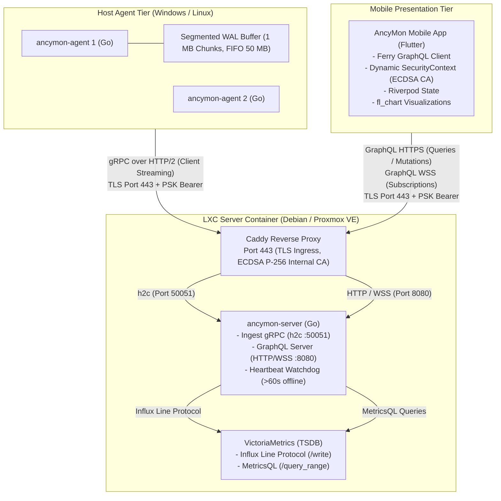

# AncyMon - System Architecture Reference

This skill provides an authoritative technical reference for the 3-tier distributed architecture, network topology, communication contracts, and security model of **AncyMon**.

---

## 1. Three-Tier Distributed Topology



---

## 2. Core Architectural Specifications

### 2.1. Host Agent (`ancymon-agent`)
* **Language & Build**: Go (Golang), statically linked binaries (`ancymon-agent` for Linux ELF, `ancymon-agent.exe` for Windows). Zero external runtime dependencies (`CGO_ENABLED=0`).
* **Service Lifecycle**: Native `systemd` daemon unit (Linux) and Windows Service Control Manager via `kardianos/service`.
* **Sampling Rate**: Fixed 1-second interval (1 Hz).
* **Filesystem Whitelist Filter**: Only inspect partitions matching: `ext4`, `xfs`, `btrfs`, `zfs`, `ntfs`, `vfat`, `fat32`, `apfs`. All virtual/pseudo-filesystems (`tmpfs`, `devtmpfs`, `squashfs`, `overlay`, `/proc`, `/sys`) are strictly ignored.
* **Offline Segmented WAL (Write-Ahead Log)**:
  - Fixed-size 1 MB segment files in `./buffer/` (e.g., `segment_000001.wal`).
  - Total buffer ceiling: 50 MB (maximum 50 segments).
  - FIFO eviction: automatically delete oldest completed segment when folder hits 50 MB.
  - Memory bounds: flat RSS memory profile (~10–15 MB) under all network partition scenarios.
  - Chronological replay: upon reconnect, new incoming measurements append to the WAL tail, worker drains segments oldest to newest, deleting segments only after gRPC ACK. Direct live streaming resumes only when zero backlog files remain.
* **gRPC Keepalive Settings**:
  - `grpc.keepalive_time_ms = 30000` (ping every 30s)
  - `grpc.keepalive_timeout_ms = 10000` (10s timeout)
  - `grpc.keepalive_permit_without_stream = true`

### 2.2. Central Server (`ancymon-server` + Infra)
* **Ingestion**: gRPC over HTTP/2, keepalive enforcement (`MinTime = 15s`, `PermitWithoutStream = true`, `ServerTime = 60s`, `ServerTimeout = 20s`).
* **Authentication**: Pre-Shared Key (PSK) Bearer token verified in gRPC stream interceptor and GraphQL connection params.
* **Time-Series Storage**: VictoriaMetrics:
  - Ingestion: Influx Line Protocol on `/write`.
  - Queries: MetricsQL `/api/v1/query_range` with dynamic `step` calculated for ~100–300 points per chart.
* **Heartbeat Watchdog**: Transition machine status to `offline` after >60 seconds of telemetry inactivity.
* **GraphQL Operations**:
  - `fleetSummary` (WebSocket subscription for main dashboard)
  - `machineMetrics(machineId)` (full 1 Hz WebSocket subscription for active detail view)
  - `machineHistory(machineId, metric, range, date)` (HTTPS POST historical analytical queries with 1h, 6h, 12h, 24h, 3d, 7d, and calendar filters)
  - `deleteMachine(machineId)` (mutation to prune decommissioned hosts)

### 2.3. Caddy Reverse Proxy & Internal ECDSA CA
* Internal CA (`tls internal`) using elliptic curve ECDSA (P-256) for minimal certificate footprint.
* Pairing QR JSON payload:
  `{"ip":"192.168.1.50","port":443,"token":"<PSK>","ca":"<COMPACT_BASE64>"}`
* Raw Base64 DER bytes without PEM headers/linebreaks yield ~600–700 characters (fits cleanly on QR Version 10–12).

### 2.4. Mobile Client Application (`mobile/`)
* **State Architecture**: `flutter_riverpod`.
* **GraphQL Client**: Ferry (`ferry`, `ferry_flutter`) with compile-time code generation via `build_runner`.
* **Dynamic TLS**: Inject raw ECDSA CA into Dart's `SecurityContext` at runtime. No OS-level root installation required.
* **Visualization Engine**: `fl_chart`.

---

## 3. Directory Layout

```text
ancymon/
├── .agents/                    # Antigravity agent configuration & skills
│   ├── rules/AGENTS.md         # Workspace operational rules
│   ├── agents/                 # Specialized subagent definitions
│   └── skills/                 # Procedural skills and runbooks
├── agent/                      # Host Agent in Go (ancymon-agent)
│   ├── cmd/                    # Daemon and CLI entrypoints
│   ├── internal/collector/     # Hardware metrics collection (gopsutil)
│   ├── internal/wal/           # Segmented WAL offline disk buffer
│   └── internal/transport/     # gRPC streaming client & keepalive
├── server/                     # Central Server in Go (ancymon-server)
│   ├── cmd/                    # Server entrypoint and QR generator
│   ├── internal/grpc/          # gRPC ingestion service & auth interceptor
│   ├── internal/storage/       # VictoriaMetrics integration (Influx/MetricsQL)
│   ├── internal/watchdog/      # Host cache & Heartbeat Watchdog
│   └── internal/graphql/       # GraphQL schema, resolvers, & subscriptions
├── mobile/                     # Flutter Mobile App (AncyMon Client)
│   ├── lib/core/security/      # Dynamic SecurityContext & ECDSA CA
│   ├── lib/core/graphql/       # Ferry client & Riverpod providers
│   ├── lib/features/pairing/   # Camera QR scanner (mobile_scanner)
│   ├── lib/features/dashboard/ # Fleet list & status widgets
│   └── lib/features/detail/    # Metric cards & fl_chart graphs
├── proto/                      # Protocol Buffers (telemetry.proto)
├── graphql/                    # GraphQL schema (schema.graphql)
└── deploy/                     # Deployment configs (Caddyfile, docker-compose)
```
