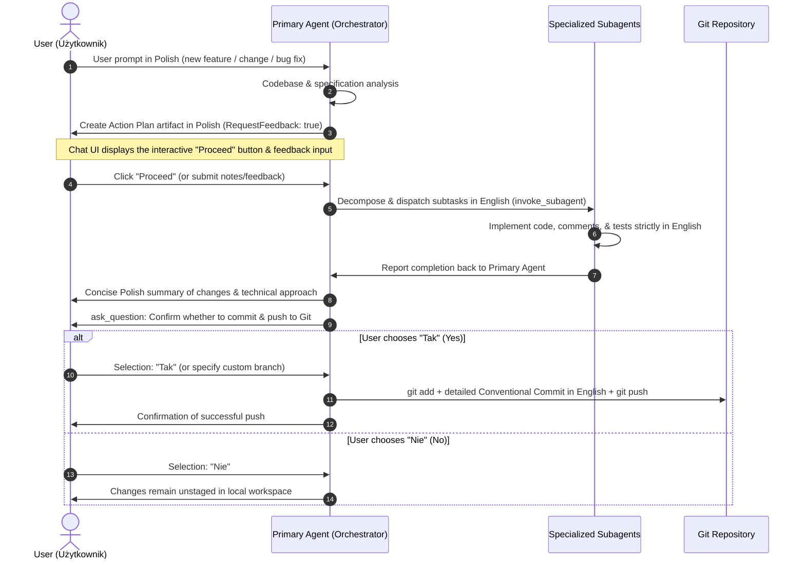

# AncyMon Development & Git Orchestration Workflow

This skill defines the strict, repeatable workflow for executing any task (new feature, refactoring, bug fix) within the **AncyMon** project.

---

## Language Standard Within the Workflow
1. **User Communication & Action Plan (`plan.md`)**: Always written in **Polish**.
2. **Codebase, Code Comments, Commit Messages & Subagent Instructions**: Always written strictly in **English**.

---

## The 5-Step Execution Cycle



---

## STEP 1: Request Analysis
1. Analyze the user's prompt.
2. Cross-reference `specification.md` and current repository structure (`agent/`, `server/`, `mobile/`, `proto/`, `graphql/`, `deploy/`).
3. Identify affected subsystems and which specialized subagents must be invoked.

---

## STEP 2: Action Plan Preparation (Artifact + "Proceed" Button)

1. Formulate a concise, bulleted action plan.
2. **Language requirement**: The plan text must be written in **Polish**.
3. Save the plan file in the artifact directory: `<appDataDir>/brain/<conversation-id>/plan.md`.
4. Provide `ArtifactMetadata` with `RequestFeedback: true`:
   ```json
   {
     "Path": "<appDataDir>/brain/<conversation-id>/plan.md",
     "Content": "# Plan Działań: ...\n\n## Zakres prac:\n1. ...",
     "ArtifactMetadata": {
       "Summary": "Krótki opis proponowanych działań",
       "UserFacing": true,
       "RequestFeedback": true
     }
   }
   ```
5. **Halt execution.** Do not make code modifications.
   - The UI displays the interactive **"Proceed"** button and feedback text box.
   - If the user provides feedback, adjust the plan and re-submit it with `RequestFeedback: true`.

---

## STEP 3: Task Delegation to Subagents (`invoke_subagent`)

Once the user clicks "Proceed":
1. Dispatch tasks to the relevant subagents:
   - `ancymon-agent-engineer` (Go host agent, 1 Hz OS metrics, WAL buffer, gRPC keepalive)
   - `ancymon-server-engineer` (Go backend, VictoriaMetrics, GraphQL server, Caddy TLS)
   - `ancymon-flutter-engineer` (Flutter app, Riverpod, Ferry codegen, SecurityContext, fl_chart)
   - `ancymon-protocol-engineer` (Protobuf definitions, GraphQL schema, pairing JSON)
   - `ancymon-qa-engineer` (WAL resilience tests, gRPC keepalive tests, Flutter integration)
2. Use `invoke_subagent`:
   ```json
   {
     "TypeName": "ancymon-agent-engineer",
     "Role": "Host Agent Engineer",
     "Prompt": "Detailed technical instruction written in English specifying target files and expected behaviors."
   }
   ```
3. Ensure all generated code, comments, and identifiers are strictly in **English**.
4. Collect results and verify that code builds and passes tests.

---

## STEP 4: Implementation Summary

Provide the user with a concise summary message in **Polish**:
* **Co udało się opracować:** List of completed features, refactorings, or bug fixes.
* **W jaki sposób:** Architecture, patterns, mechanisms, and libraries used.
* **Wyniki weryfikacji:** Build status and test results.

---

## STEP 5: Interactive Git Decision (`ask_question`) & Push

Immediately follow the summary with an `ask_question` call:

```json
{
  "questions": [
    {
      "question": "Prace zostały zakończone. Czy chcesz zatwierdzić zmiany i wysłać je do repozytorium Git?",
      "options": [
        "(Recommended) Tak, wykonaj commit na bieżącej gałęzi i push do repozytorium",
        "Nie, chcę najpierw przejrzeć zmiany lokalnie bez commitowania"
      ],
      "is_multi_select": false
    }
  ]
}
```

### Handling the User's Choice:

1. **If the user chooses "Tak" (Yes)**:
   - Check current branch: `git branch --show-current`.
   - If user specified a different branch in write-in, switch or create it: `git checkout -b <branch>` or `git checkout <branch>`.
   - Stage changes: `git add .` (with `BypassSandbox: true` if .git access is restricted).
   - Author a comprehensive Conventional Commits message written in **English**:
     ```bash
     git commit -m "$(cat << 'EOF'
     feat(scope): concise one-line subject in English

     Detailed description of changes:
     - Implemented X in module Y following specification guidelines.
     - Added error handling for edge case Z.
     - Updated automated unit and integration tests.

     Technical Rationale:
     - Preserves zero external runtime dependencies on the host agent.
     - Enforces compile-time type safety via Ferry GraphQL client.
     EOF
     )"
     ```
   - Push to remote: `git push origin <branch>`.
   - Inform the user in Polish of the successful commit and push with commit hash and branch name.

2. **If the user chooses "Nie" (No)**:
   - Inform the user in Polish that changes remain unstaged in the local workspace for review.
