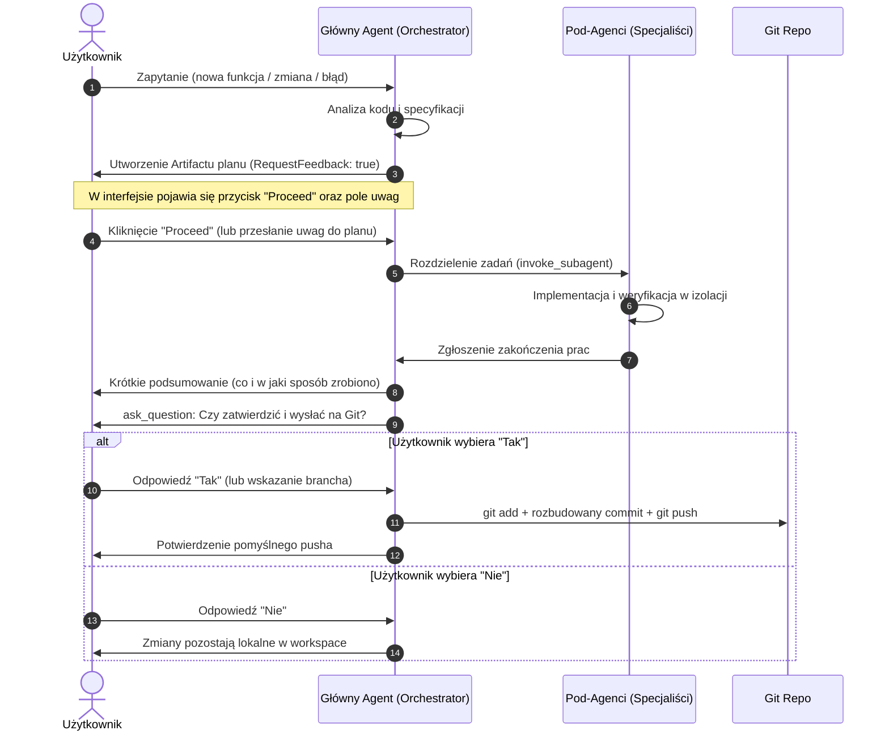

# AncyMon Development & Git Orchestration Workflow

Ten skill definiuje ścisły, powtarzalny proces realizacji każdego zadania (nowa funkcja, refaktoryzacja, poprawka błędu) w projekcie **AncyMon**.

---

## 5-Krokowy Proces Realizacji Zadania



---

## KROK 1: Analiza Zapytania
1. Zapoznaj się z treścią zapytania użytkownika.
2. Odnieś się do pliku `specification.md` oraz istniejącej struktury projektu (`agent/`, `server/`, `mobile/`, `proto/`, `graphql/`, `deploy/`).
3. Zidentyfikuj, które warstwy systemu wymagają modyfikacji i którzy pod-agenci powinni zostać zaangażowani.

---

## KROK 2: Przygotowanie Planu (Artifact + "Proceed" Button)

1. Przygotuj zwięzły plan działań w postaci pliku Artifact.
2. Zapisz plik planu w katalogu artefaktów: `<appDataDir>/brain/<conversation-id>/plan.md`.
3. **Kluczowy wymóg**: Podczas wywołania `write_file` **zawsze** przekaż `ArtifactMetadata`:
   ```json
   {
     "Path": "<appDataDir>/brain/<conversation-id>/plan.md",
     "Content": "# Plan Implementacji: ...\n\n## Zakres prac:\n1. ...\n2. ...",
     "ArtifactMetadata": {
       "Summary": "Krótki, 2-3 linijkowy opis proponowanych działań",
       "UserFacing": true,
       "RequestFeedback": true
     }
   }
   ```
4. **Zatrzymaj dalsze wykonywanie narzędzi.** Poczekaj na interakcję użytkownika.
   - Użytkownik zobaczy w interfejsie przycisk **"Proceed"** oraz pole do wpisania opcjonalnych uwag.
   - Jeśli użytkownik wpisze uwagi zamiast kliknąć "Proceed", zmodyfikuj plan za pomocą `edit_file` lub `write_file` (ponownie z `RequestFeedback: true`) i poczekaj na zatwierdzenie.

---

## KROK 3: Rozdzielenie Zadań do Pod-Agentów (`invoke_subagent`)

Po otrzymaniu potwierdzenia ("Proceed"):
1. Sprawdź, którzy specjaliści są potrzebni:
   - `ancymon-agent-engineer` (Go host agent, OS metryki, bufor WAL, gRPC keepalive)
   - `ancymon-server-engineer` (Go serwer, VictoriaMetrics, GraphQL serwer, Caddy)
   - `ancymon-flutter-engineer` (Aplikacja Flutter, Riverpod, Ferry, SecurityContext, UI)
   - `ancymon-protocol-engineer` (Kontrakty proto/ i schema.graphql, format parowania)
   - `ancymon-qa-engineer` (Testy odporności WAL, keepalive, integracja)
2. Wywołaj narzędzie `invoke_subagent`:
   ```json
   {
     "TypeName": "ancymon-agent-engineer",
     "Role": "Host Agent Developer",
     "Prompt": "Instrukcja precyzująca zadanie, pliki docelowe oraz oczekiwany rezultat."
   }
   ```
3. Odbierz komunikaty zwrotne od pod-agentów, zweryfikuj czy zadania zostały wykonane poprawnie i czy kompilacja/testy przechodzą pomyślnie.

---

## KROK 4: Krótkie Podsumowanie dla Użytkownika

Przedstaw użytkownikowi zwięzły raport bezpośrednio w wiadomości:
* **Co udało się opracować:** Lista zrealizowanych funkcjonalności lub naprawionych błędów.
* **W jaki sposób:** Zastosowane mechanizmy, algorytmy, użyte biblioteki i decyzje architektoniczne.
* **Wyniki weryfikacji:** Krótka informacja o testach/walidacji.

---

## KROK 5: Interaktywne Zapytanie o Git (`ask_question`) i Push

Zaraz po podsumowaniu wywołaj narzędzie `ask_question`, aby użytkownik mógł w interaktywnym oknie dialogowym wybrać dalsze działanie:

```json
{
  "questions": [
    {
      "question": "Prace zostały zakończone. Czy chcesz zatwierdzić zmiany i wysłać je do repozytorium Git?",
      "options": [
        "(Recommended) Tak, wykonaj commit na bieżącej gałęzi i push do repozytorium",
        "Nie, chcę najpierw przejrzeć zmiany lokalnie bez commitowania"
      ],
      "is_multi_select": false
    }
  ]
}
```

### Obsługa Wyboru Użytkownika:

1. **Jeśli użytkownik wybrał opcję 'Tak'**:
   - Sprawdź obecną gałąź: `git branch --show-current`.
   - Jeśli użytkownik podał w polu write-in inną gałąź (np. `feature/xyz`), przełącz lub utwórz tę gałąź: `git checkout -b <branch>` lub `git checkout <branch>`.
   - Zindeksuj pliki: `git add .` (lub wybrane zmodyfikowane pliki).
   - Stwórz **rozbudowany komentarz commita** w standardzie Conventional Commits:
     ```bash
     git commit -m "$(cat << 'EOF'
     feat(komponent): zwięzły jednolinijkowy nagłówek

     Szczegółowy opis wprowadzonych zmian:
     - Implementacja X w pliku Y z zachowaniem wymogów specyfikacji.
     - Obsługa scenariusza Z w module W.
     - Zaktualizowanie testów jednostkowych i integracyjnych.

     Uzasadnienie techniczne / Architektura:
     - Zapewnienie zerowych zależności runtime na hoście.
     - Zgodność z kontraktem gRPC/GraphQL.
     EOF
     )"
     ```
   - Wyślij zmiany do zdalnego repozytorium:
     ```bash
     git push origin <gałąź>
     ```
   - Poinformuj użytkownika o udanym commicie i pushu, podając skrót hasha i nazwę gałęzi.

2. **Jeśli użytkownik wybrał opcję 'Nie'**:
   - Poinformuj użytkownika, że zmiany pozostały w stanie roboczym w katalogu projektu i może je przejrzeć w dowolnej chwili.
